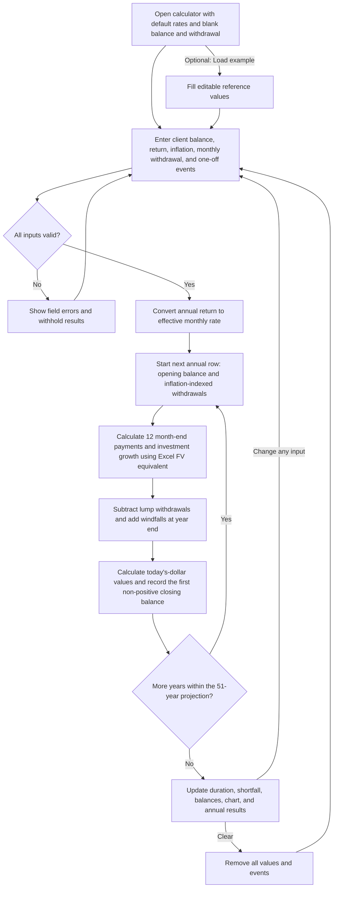

# How the calculator works

The same calculated rows feed the summary, the chart, the desktop table, and the expandable year cards. The chart compares each year's opening balance with its opening value in today's dollars using paired columns for Years 0–50. It receives the engine's existing depletion result to mark the end of the first non-positive year; it does not recalculate depletion. Its accessible description distinguishes first shortfall from survival through the finite horizon. The marker retains the first shortfall even after a later recovery; no separate duration summary box is shown. Tooltips show the selected row's opening amounts, regular withdrawals, any nonzero events, and closing amounts. A year-end event changes the following year's opening columns, not the opening of the year in which it occurs. The calculator starts with an editable 7.5% average annual return and 3% average annual inflation. Starting balance and monthly withdrawal remain blank until entered. Load example fills the full reference scenario; Clear removes all values and events. A change to any input creates a new projection; there are no fixed result values.

For Year 0, the opening balance is the user's starting balance and regular annual withdrawals are 12 times the initial monthly amount. Later rows use the prior closing balance, or zero if that closing balance was negative. Regular withdrawals increase with inflation only when the new opening balance is positive.

The model continues through all 51 years after a shortfall so later one-off events are represented. It retains the first negative closing balance. A later windfall can restore a positive balance, but does not restart regular withdrawals once their amount has become zero. These rules reproduce the source spreadsheet.

Year 0 represents the first 12 months. The event editor uses projection years 0–50, matching the annual table, and applies each event at the end of its selected row. At the form boundary, projection year 0 becomes engine end-year 1 and projection year 50 becomes engine end-year 51. Loaded example events convert back to the corresponding projection years. Annual reporting identifies the first year with a shortfall rather than an exact depletion month.

Monetary fields accept plain or correctly comma-grouped amounts. Commas are applied after editing, without rewriting the value on focus or moving the cursor while typing. Decimal text is preserved without rounding. Blank inputs remain blank rather than becoming zero. Percentages and projection years are not grouped.

Adding or editing a one-off event opens a dialog with its own draft state. Save validates and commits the event; Cancel and Escape discard the draft. Only saved events feed the projection. The input card lists their type, amount, and selected year, with Edit and Remove controls. Longer lists scroll within the card.

Pagination changes only the visible rows. The default ranges are Years 0–10, 11–20, 21–30, 31–40, and 41–50; Year 0 is included in the first range rather than leaving Year 50 on a page of its own. The 25-year setting shows 0–25 and 26–50. All 51 rows remain available together, and the chart and summary always use the complete projection.
