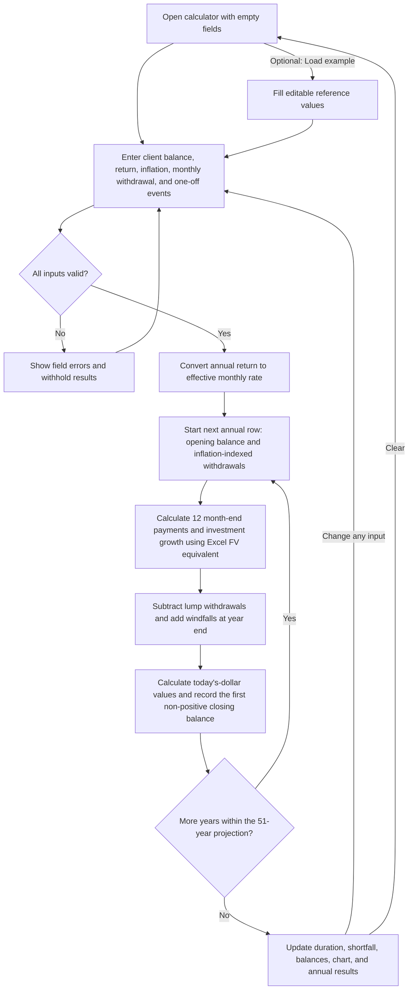

# How the calculator works

The same calculated rows feed the summary, the chart, the desktop table, and the expandable year cards. The calculator starts with an editable 7.5% average annual return and 3% average annual inflation. Starting balance and monthly withdrawal remain blank until entered. Load example fills the full reference scenario; Clear removes all values and events. A change to any input creates a new projection; there are no fixed result values.

For Year 0, the opening balance is the user's starting balance and regular annual withdrawals are 12 times the initial monthly amount. Later rows use the prior closing balance, or zero if that closing balance was negative. Regular withdrawals increase with inflation only when the new opening balance is positive.

The model continues through all 51 years after a shortfall so later one-off events are represented. It retains the first negative closing balance. A later windfall can restore a positive balance, but does not restart regular withdrawals once their amount has become zero. These rules reproduce the source spreadsheet.

Year 0 represents the first 12 months. An event for End year 1 therefore applies to Year 0; End year 51 applies to Year 50. Annual reporting identifies the first year with a shortfall rather than an exact depletion month.
